# 📊 Financial Dashboard: Анализ денежных потоков компании

## 📋 О проекте

Интерактивный дашборд для визуального анализа банковских операций компании за период 2022–2025 гг. Проект демонстрирует методологию анализа оборотов денежных средств, выявления паттернов хозяйственной деятельности и визуализации финансовых данных.

> ⚠️ **Важно:** Все данные в репозитории анонимизированы в учебных и демонстрационных целях. Названия контрагентов, ИНН и даты смещены с сохранением всех бизнес-пропорций, трендов и длительности отношений.

## 📁 Источник данных

Все расчеты и визуализации построены на основе анонимизированной выписки по расчетному счету, содержащей более 10 000 операций. Исходные данные с рабочими формулами доступны в файле:

📊 **[Dashboard_Anonymized.xlsx](data/processed/Dashboard_Anonymized.xlsx)** — анонимизированные данные, расчетные таблицы и формулы (`СУММЕСЛИМН`, `ИНДЕКС`+`ПОИСКПОЗ`, `МИНЕС`/`МАКСЕС`).

## Цель анализа

Визуально и математически исследовать:

1. **Ритмичность деятельности:** Непрерывность и равномерность коммерческих операций во времени.
2. **Кредитную дисциплину:** Целевое использование и возврат кредитных средств.
3. **Структуру потоков:** Соотношение поступлений и списаний по категориям.
4. **Долгосрочные отношения:** Длительность и стабильность связей с контрагентами.

## 📈 Визуализация ключевых метрик

### Блок 1. Макро-баланс коммерции

#### Д1.1 — Структура поступлений и списаний (Sunburst)

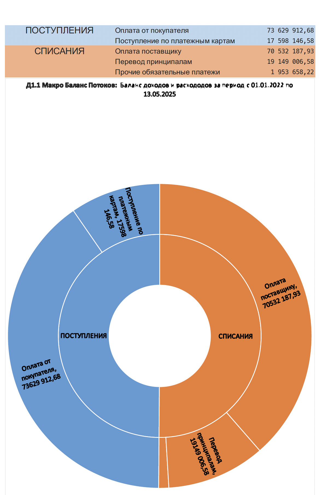

**Что показывает:** Иерархическая структура всех денежных потоков компании с детализацией до отдельных статей.
**Почему Sunburst:** Этот тип диаграммы позволяет одновременно показать общую картину (внешнее кольцо) и детализацию (внутренние кольца) в одном визуальном элементе, что идеально для демонстрации структуры сложных данных.

---

### Блок 2. Годовая динамика

#### Д2.1 — Коммерческие поступления по годам

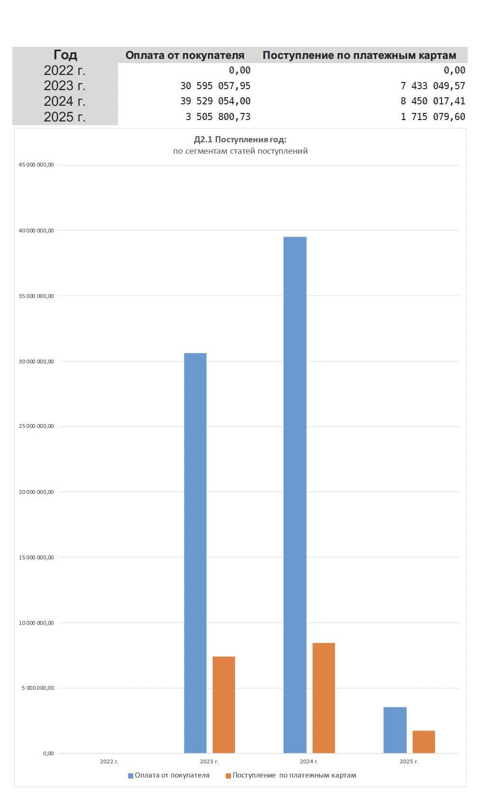

**Что показывает:** Сравнение объемов коммерческих поступлений за каждый год анализируемого периода.
**Почему группированная гистограмма:** Позволяет наглядно сравнить абсолютные значения по годам и увидеть тренд роста/снижения.

#### Д2.2 — Коммерческие списания по годам с детализацией

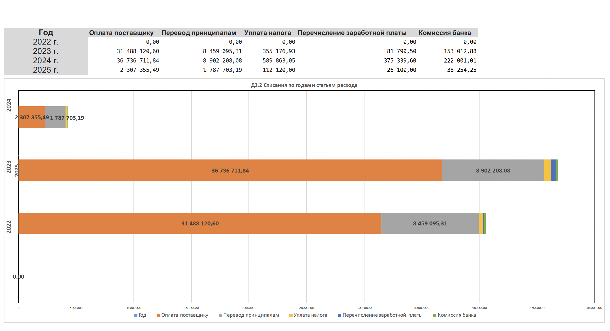

**Что показывает:** Структура расходов по годам с разбивкой по ключевым статьям (поставщики, налоги, ФОТ).
**Почему стековая гистограмма:** Показывает как общий объем списаний, так и долю каждой статьи в общей структуре расходов.

---

### Блок 3. Помесячный ритм

#### Д3.1 — Динамика поступлений по месяцам

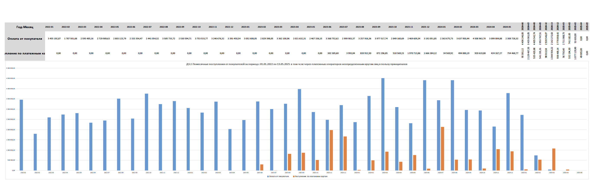

**Что показывает:** Помесячная динамика поступлений с маркерами ключевых точек.
**Почему линейный график с маркерами:** Линия показывает тренд и непрерывность процесса, маркеры выделяют конкретные месяцы для детального анализа.

#### Д3.2 — Динамика списаний по месяцам

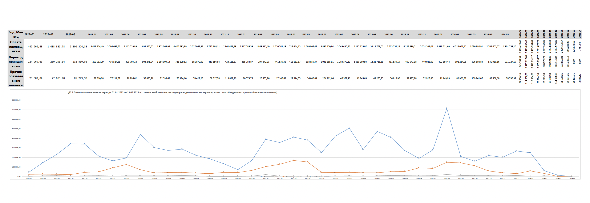

**Что показывает:** Помесячная динамика списаний в сравнении с поступлениями.
**Почему линейный график:** Позволяет увидеть сезонность, ритмичность и возможные аномалии в расходах.

---

### Блок 4. Кредитная дисциплина

#### Д4.1 — Кредитный цикл (Waterfall)

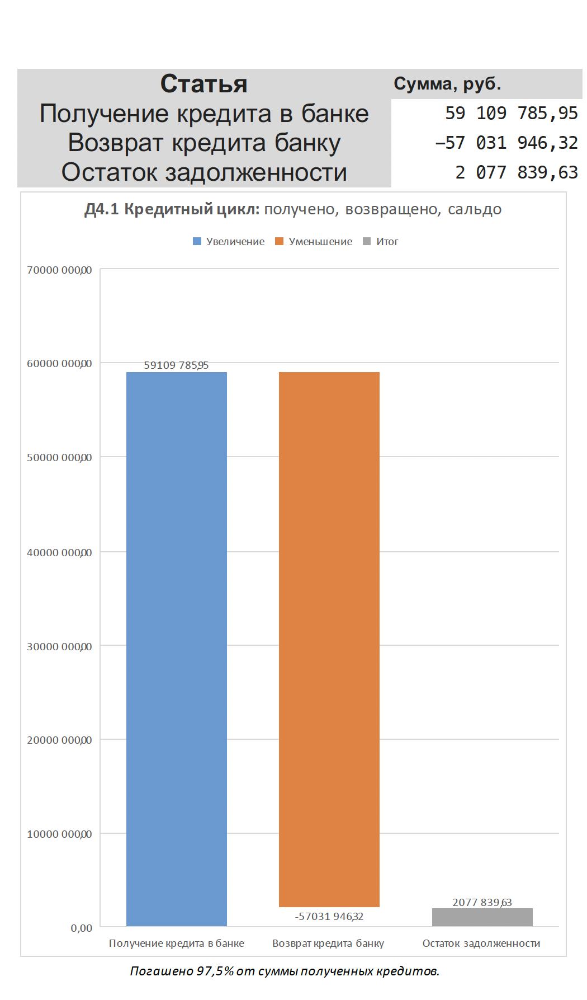

**Что показывает:** Движение кредитных средств от получения до возврата с промежуточными этапами.
**Почему Waterfall:** Этот тип диаграммы идеально показывает, как начальное значение (полученный кредит) трансформируется через промежуточные операции (возвраты) в конечный результат (остаток задолженности).

#### Д4.2 — Получение vs Возврат кредитов по годам

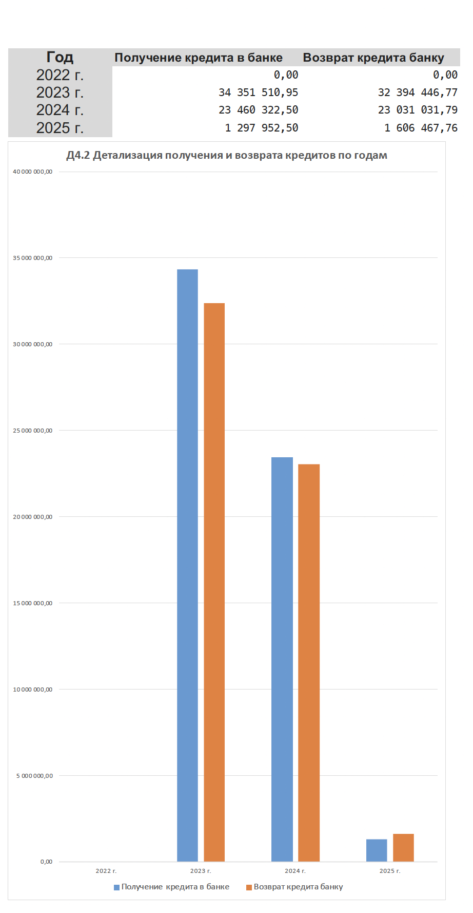

**Что показывает:** Сравнение объемов получения и возврата кредитов по каждому году.
**Почему группированная гистограмма:** Позволяет напрямую сравнить два показателя (получено/возвращено) для каждого года и оценить дисциплину возврата.

---

### Блок 5. Прозрачность операций

#### Д5.1 — Детализация обязательных платежей

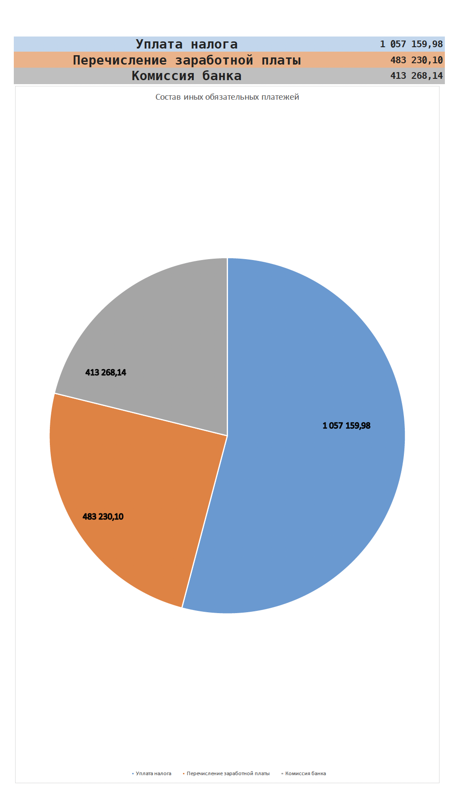

**Что показывает:** Структура обязательных платежей (налоги, ФОТ, комиссии) в общем объеме расходов.
**Почему круговая диаграмма:** Показывает долю каждой категории обязательных платежей в общей структуре.

#### Д5.2 — Баланс возвратов

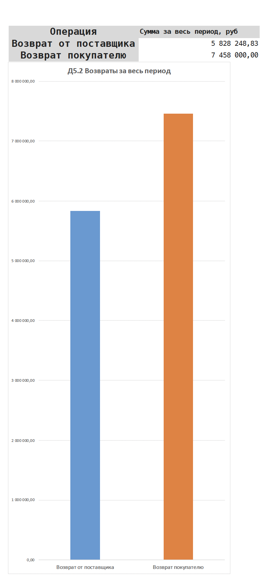

**Что показывает:** Сравнение объемов возвратов от поставщиков и покупателям.
**Почему сравнительная гистограмма:** Демонстрирует симметричность и незначительность объемов возвратов.

#### Д5.3 — Баланс внутренних переводов

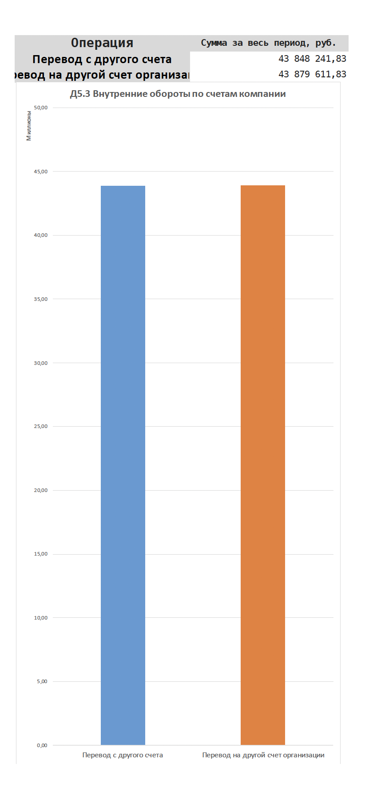

**Что показывает:** Соотношение переводов между собственными счетами компании.
**Почему сравнительная гистограмма:** Показывает сбалансированность внутренних перемещений средств.

#### Д5.4 — Детализация зарплатных выплат

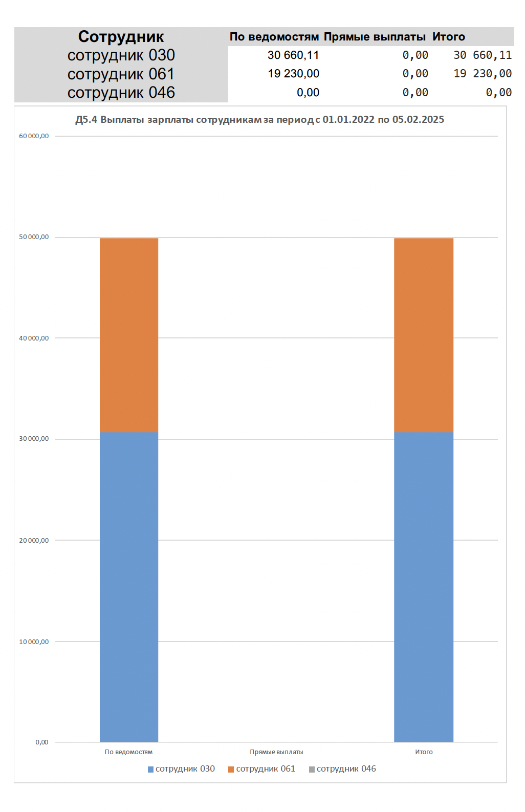

**Что показывает:** Распределение фонда оплаты труда по сотрудникам с детализацией по способам выплат.
**Почему линейчатая диаграмма с накоплением:** Позволяет показать как общую сумму выплат каждому сотруднику, так и структуру (по ведомостям/на карту).

---

### Блок 6. Длительность отношений

#### Д6.1 — Динамика расчетов с ключевыми поставщиками

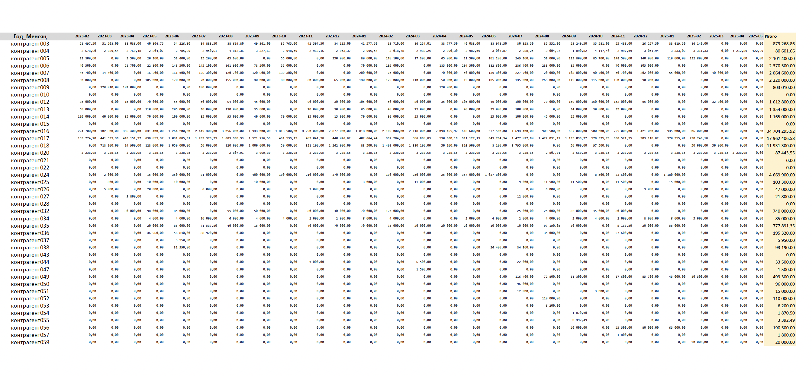

**Что показывает:** Помесячная динамика платежей ключевым поставщикам за весь период анализа.
**Почему линейный график с несколькими линиями:** Каждая линия — отдельный поставщик, что позволяет увидеть длительность и непрерывность сотрудничества с каждым из них.

---

## Технический стек и методология

- **Инструмент:** Microsoft Excel (без макросов в финальном файле, только формулы).
- **Обработка данных:** `СУММЕСЛИМН`, `ИНДЕКС` + `ПОИСКПОЗ`, `МИНЕС`/`МАКСЕС` для агрегации массивов >10 000 строк.
- **Анонимизация:** Собственный алгоритм маппинга уникальных ИНН с генерацией псевдонимов по категориям (Банк, Бюджет, Сотрудник, Контрагент).
- **Визуализация:** Кастомные диаграммы Sunburst, Waterfall, Clustered Column, Line with Markers.

## 📥 Материалы проекта

- 📄 **[PDF-дашборд (13 стр.)](dashboard/Financial_Dashboard.pdf)** — готовый отчет с визуализациями и выводами.
- 📊 **[Excel-файл с формулами](data/processed/Dashboard_Anonymized.xlsx)** — анонимизированные данные и расчетные таблицы.

> 💡 **Как скачать файлы:** Кликните на ссылку выше. Для PDF — файл откроется в браузере, используйте кнопку скачивания браузера. Для Excel — нажмите "View raw" или правую кнопку мыши → "Сохранить как".

---

_Проект разработан как практический кейс по финансовому анализу и визуализации данных._
